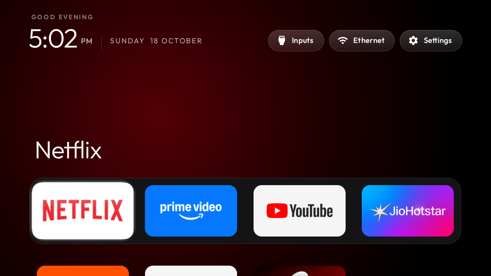

# tv-ambient-home

My Xiaomi Google TV, minus the ads, plus an ambient light behind it.

This is the setup that runs my living-room TV (Xiaomi MiTV-MOOR2, Google TV / Android 11): the preloaded
bloat disabled over Wi-Fi, a clean Apple-TV-style home screen, and a few add-ons of my own, including a
Bluetooth LED strip that follows the picture. Everything is done through the TV's own developer options:
no root, nothing flashed, nothing uninstalled, and a one-line restore.

> **Built on [CleanYourTV](https://github.com/Gathin23/cleanyourtv) by Gathin.** The launcher, the debloat
> prompt, the ADB tools and the safety rules come from that project and its 300+ contributors. This repo
> trims it down to one TV and adds my own work on top. See [`CREDITS.md`](CREDITS.md) for who did what,
> and please support the original.

## What's in it

| Part | What it does |
|---|---|
| **Debloat list** | [`examples/xiaomi-mitv-moor2/debloat.txt`](examples/xiaomi-mitv-moor2/debloat.txt): Xiaomi telemetry, ad and promo rows, PatchWall, Mi Cast, store demo and the rest, disabled with `pm disable-user`. |
| **Home screen** | [`launcher/`](launcher/): a small native launcher (plain Java, no network permission) with a dock, a top shelf, an app grid, one glass highlight, an Inputs menu and a clock screensaver. My `config.xml` sets the dock, six columns and the Bengaluru time-of-day sky. |
| **Ambient light** | [`addons/ambilight/`](addons/ambilight/): drives a Bluetooth LEDDMX strip from the TV's own colour taking (works with Netflix, Prime and other protected video), with beat flashes, and comes back by itself after standby, reboots and updates. |
| **Weather** | [`addons/weather/`](addons/weather/): a seven-day forecast tile (Open-Meteo), fetched only while open. |
| **Phone remote** | [`addons/phoneremote/`](addons/phoneremote/): QR codes and steps for using a phone as the remote. |
| **Tools** | [`tools/`](tools/): a pure-Python ADB client (`tv.py`), debloat, restore, drift check after firmware updates, themes, and a check that ADB is closed afterwards. |
| **Themes** | [`themes/`](themes/): `default` and `aurora`, pushed without a rebuild by `tools/theme.sh`. |

| | |
|---|---|
|  |  |
| *Top shelf and ambient glow* | *Inputs menu* |
|  |  |
| *The app grid* | *Aurora theme* |

## The TV

| TV | OS |
|---|---|
| Xiaomi MiTV-MOOR2 (venom, MediaTek) | Google TV 11 |

Firmware RTM5.220609.003.2674. On this firmware the stock launcher is `com.google.android.apps.tv.launcherx`
and the Live TV app is `com.mitv.livetv`. The stock Google TV home stays **enabled** on purpose, because voice
search shows its results inside it; the launcher sends that home screen back whenever it comes up on its
own, and the Home button always opens the new launcher. Other Xiaomi and Google TV sets are close, but the
list was only lived with on this one. [`examples/README.md`](examples/README.md) has its notes.

## The launcher

About 470 KB, plain Java, built for TVs with 1 GB of RAM: no network permission, no blur or video, no
background services. The TV needs Android 8.0 (API 26) or newer (`minSdk` in
[`launcher/app/build.gradle`](launcher/app/build.gradle)); see [`docs/TROUBLESHOOTING.md`](docs/TROUBLESHOOTING.md)
for older sets. Dock, columns, hidden apps, remote keys, volume acceleration and the Bluetooth pill are set in
[`config.xml`](launcher/app/src/main/res/values/config.xml); hold OK on the Settings pill for Launcher settings
on the TV. It follows the TV's language (25 languages) and has a clock screensaver, an app library
([guide](docs/app-library.md)) and module cards ([`docs/modules.md`](docs/modules.md)).

## Set up

You need a computer on the same Wi-Fi as the TV.

1. **On the TV:** Settings → System → About → press OK on **Android TV OS build** seven times → back →
   Developer options → **USB debugging** on (and Network debugging if offered).
2. **Tools:** `python3 -m venv tools/venv && tools/venv/bin/pip install -r tools/requirements.txt`, then
   `TV_HOST=<tv ip> tools/venv/bin/python -I tools/tv.py --probe` and accept "Allow USB debugging?" on the TV.
3. **Debloat:** `TV_HOST=<tv ip> tools/disable.sh examples/xiaomi-mitv-moor2/debloat.txt`. It records the
   TV's state in `~/.cleanyourtv/` first.
4. **Home screen:** `cd launcher && TV_HOST=<tv ip> STOCK_LAUNCHER=com.google.android.apps.tv.launcherx ./build-and-install.sh`
   (JDK 17 and Android SDK platform 34).
5. **Add-ons:** in each `addons/<name>/`, `./gradlew --no-daemon assembleRelease`, then install the APK with
   `tools/tv.py --push` and `pm install -r`. Each add-on's README has its own steps and permissions.
6. **Close ADB afterwards:** turn off USB and Network debugging, revoke the authorisations, reboot, and
   check with `tools/venv/bin/python -I tools/adb-closed.py <tv ip>`. Port 5555 is unencrypted.

You can also hand the whole job to a coding assistant (Claude Code, Codex, Gemini CLI): paste
[`PROMPT.md`](PROMPT.md) and it follows the same steps, asking before it touches anything you use.
Coding agents should read [`AGENTS.md`](AGENTS.md).

## Undo, and firmware updates

```bash
TV_HOST=<tv ip> tools/restore.sh examples/xiaomi-mitv-moor2/debloat.txt com.google.android.apps.tv.launcherx
```

Restore replays the record taken before the first change, so Home goes back to the stock launcher and
everything disabled comes back. A firmware update re-enables preloads; compare and fix with
`TV_HOST=<tv ip> tools/venv/bin/python -I tools/check.py examples/xiaomi-mitv-moor2/debloat.txt --fix`.

## Privacy audit

[`tools/privacy.py`](tools/privacy.py) lists what the TV runs for voice, ACR and telemetry, with the evidence
for each name: which packages the firmware nominated, which are known components, which only matched by
name, and which actually used the microphone since boot. What the audit cannot do is prove intent: it never
claims a package is listening. `--write <file>` turns its findings into a list for `tools/disable.sh`.

## When something goes wrong

[`docs/TROUBLESHOOTING.md`](docs/TROUBLESHOOTING.md) has the long list. Lessons from this TV:

- **The TV feels slow:** check `top` first. On this TV it was once an AirPlay receiver app spinning at 100% CPU,
  not the Wi-Fi.
- **An app hangs on its splash right after the screensaver:** Google TV starts its own home screen when the
  screensaver ends, and on a TV short of memory it can show up late. The launcher now waits and leaves a
  just-opened app alone; on an older build, press Back and open the app again (or force-stop it).
- **The LED strip says "ready" but stays dark:** the LEDDMX controller drops a power-on followed too quickly
  by other commands. The add-on waits 0.4 s after power-on; see [`addons/ambilight/README.md`](addons/ambilight/README.md).
- **In standby the TV is offline:** no ADB, no ping, no Wake-on-LAN. Only the remote wakes it.

## Package names

The apps keep the package names they had in the original project (`com.gathin.tvhome` for the launcher,
`io.cleanyourtv.*` for the add-ons), so they install over what is already on the TV without losing their
settings or the Home role.

## Legal

An independent personal project, not affiliated with or endorsed by Xiaomi, Google or any TV maker. It works
only through settings the TV offers its owner (Developer options, ADB, `pm disable-user`), contains no
manufacturer software, firmware or APKs, and bypasses no lock, DRM or copy protection. You run it on a TV you
own, at your own risk. Provided as is, without warranty.

## Licence

MIT, see [`LICENSE`](LICENSE), which keeps the original CleanYourTV copyright alongside mine. The Outfit
typeface is under the SIL Open Font License, see `launcher/FONT-LICENSE-OFL.txt`. Credits: [`CREDITS.md`](CREDITS.md).
